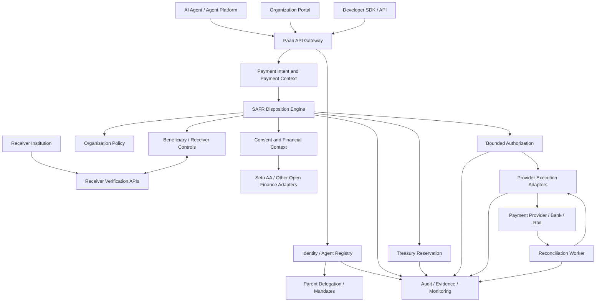

# Paari v4.0 — Federated Agentic Financial Control Plane

## Product definition

Paari is a financial governance control plane between AI agents and financial infrastructure. Its governing rule is:

> The agent proposes. Paari's control plane decides. The authorized financial institution executes.

Paari is intended to be delivered as a **SaaS control plane with a PaaS developer/API layer**. A dedicated/private deployment is an enterprise deployment option. The SaaS/PaaS product model is the target architecture; this source distribution is a deployable reference implementation, not an already-hosted commercial service.

## Client types and what they receive

| Client | Paari capability | Primary interface |
|---|---|---|
| Enterprise / organization | Tenant, parent and agent management; Agent Cards; delegation and mandates; policies; SAFR; treasury; consent/context governance; beneficiary controls; payment tracking; evidence and audit | Organization Portal + tenant-scoped API |
| Agent developer / AI platform | Agent registration, SDK/API integration, payment-intent submission, bounded authorization retrieval, status and webhooks, sandbox | Developer API, SDK and API documentation |
| Financial institution / execution provider | Provider integration contract, submission and status callbacks, reconciliation evidence, organization/receiver controls | Provider adapters and authenticated integration APIs |
| Receiver / supplier institution | Receiver registry, pinned public key, signed acceptance/rejection, post-capture credit attestation, payment-evidence view | Receiver APIs and receiver operations workflow |
| Paari operations | Tenant administration, approvals, integration oversight, security and platform operations | Internal Paari Console and restricted administrative APIs |

## Logical system flow

## Payment decision and execution sequence

1. An authenticated agent submits a payment intent with an idempotency key and its signed request proof.
2. The gateway validates session, Agent Card binding, tenant, proof, request bounds and replay state.
3. Paari validates parent authority, signed mandate, capability, amount/currency, expiry and revocation.
4. Where required by organization policy, Paari checks the consent-bound financial context, data provenance and freshness. Open Finance consent is data-access permission, not a payment mandate.
5. SAFR evaluates the request and returns `DENY`, `ESCALATE`, `AUTO_EXECUTE` or `OBSERVE` under the configured policy.
6. Treasury reserves shared exposure in the same database transaction that creates the bounded authorization. A conditional SQL update prevents the bucket counter from being incremented beyond its configured ceiling.
7. Where strict receiver precheck is enabled, the registered receiver signs an `ACCEPTED` acknowledgement for the exact intent before the agent consumes authorization. Any signed `REJECTED` acknowledgement blocks that intent.
8. The provider adapter receives a stable authorization-derived idempotency reference. If submission outcome is ambiguous, the payment remains unresolved and Paari reconciles provider-side evidence; it does not retry blindly as a new payment.
9. Reconciliation uses a durable due-time, lease, bounded backoff and dead-letter state. `PAID` is reached only through provider corroboration, not a receiver acknowledgement.
10. Audit records capture governance, treasury, receiver and provider lifecycle evidence.

## Treasury reservation semantics

- Budget policy is scoped by organization, currency and period (`DAILY`, `WEEKLY`, `MONTHLY`, `LIFETIME`).
- On authorization, Paari atomically increments the period bucket's reserved amount only if `reserved + spent + requested <= limit`.
- A provider-corroborated `PAID` state moves the reservation from reserved to spent.
- Definitive pre-settlement terminal states (`DECLINED`, `EXPIRED`, `CANCELLED`) release the reservation.
- `FAILED` and `PROVIDER_UNKNOWN` retain exposure because a late provider confirmation may still establish that money moved. Operations must resolve such reservations through provider reconciliation or controlled review.
- `PAARI_REQUIRE_TREASURY_BUDGET=1` makes a missing tenant/currency budget fail closed.

PostgreSQL row locking and conditional updates are the intended concurrency mechanism. SQLite unit tests do not certify production concurrency; the dedicated PostgreSQL contention test and workload testing must pass before live usage.

## Receiver-side verification semantics

- A receiver institution is registered with a pinned Ed25519 public key and must be locally approved by the payer organization before beneficiary use.
- `ACCEPTED` / `REJECTED` are signed receiver acknowledgements of the exact intent, amount, currency and beneficiary. With `PAARI_REQUIRE_RECEIVER_PRECHECK=1`, execution requires at least one valid `ACCEPTED`, and any `REJECTED` for the intent is a hard stop.
- `CREDIT_ATTESTED` is a separate post-capture statement. It is evidence only; it does not mutate payment/provider state or assert legal settlement.
- `ADMIN_APPROVED` is an internal Paari approval marker, not external KYB or independent legal verification.

## Provider state and reconciliation

- Authorization is single-use and bound to amount, currency, merchant, intent and agent.
- Provider adapters must use stable idempotency and provider-specific recovery contracts. Razorpay order recovery uses the stable receipt/authorization reference; PayPal uses `PayPal-Request-Id`; autonomous adapters receive authorization-derived keys.
- A transport timeout or ambiguous server response becomes `PROVIDER_UNKNOWN` or remains in a provider-submitted/captured state pending readback. Paari does not infer failure from a timeout.
- The reconciliation worker is a separate process in the production reference topology. It claims due rows with a lease, retries with bounded exponential backoff, and dead-letters unresolved rows for manual investigation.
- Receiver acknowledgements cannot create `PAID`. The provider's payment record and exact amount/currency must be independently corroborated.

## SaaS, PaaS and dedicated deployment

### SaaS control plane

The organization subscribes to a hosted Paari tenant and receives an Organization Portal, agent lifecycle management, policy and SAFR controls, mandates, treasury, consent/context governance, payment monitoring and audit access. Paari operates the shared control-plane software and infrastructure, with tenant isolation enforced at API/data boundaries.

### PaaS developer layer

External AI platforms integrate using the Paari API and SDK. They receive agent onboarding and identity primitives, payment-intent APIs, bounded authorization lifecycle, policy decision outcomes, webhooks, sandbox and integration documentation. Paari supplies governance primitives rather than requiring each developer to build an independent payment-control framework.

### Dedicated/private deployment

Large enterprises or institutions may deploy a dedicated Paari control plane in a controlled cloud account or private environment. This is a deployment option, not a substitute for provider, KMS, identity, security and regulatory approval.

### Current product gaps before commercial SaaS operation

This package does not deliver subscription billing, commercial plan entitlements/metering, enterprise SSO/SAML, SCIM lifecycle, tenant-by-tenant managed encryption keys, customer support operations, multi-region disaster recovery or an actually hosted production service. These are separate commercial/platform workstreams.

## Deployment reference

`deploy/production/docker-compose.yml` provides a self-hosted production-oriented topology:

- PostgreSQL as the durable system of record.
- A one-off migration job before API startup.
- Multiple API workers with embedded reconciliation disabled.
- A separate reconciliation worker.
- Loopback-bound API port, read-only container filesystem, dropped Linux capabilities and no-new-privileges.
- External TLS/WAF ingress and secret-manager supplied environment.

For managed cloud hosting, map the same separation to a managed PostgreSQL service, secret manager/KMS, container/orchestration service, private networking, WAF/load balancer, logs/metrics/traces and independently scaled worker deployment.

## Trust boundaries and non-goals

- Paari does not become a bank, Account Aggregator, payment aggregator or payment system operator merely by deploying this software.
- Setu Account Aggregator is a financial-information path, not a payment execution rail. Data consent never substitutes for a payment mandate.
- A provider adapter contract or sandbox response is not proof of real-money settlement capability.
- A locally approved receiver record is not a legal KYB certificate.
- `PAID` must only be used when the configured provider's authoritative state and exact bounds are independently corroborated.
- Production use requires independently completed security, resilience, provider, privacy/legal and regulatory reviews.
